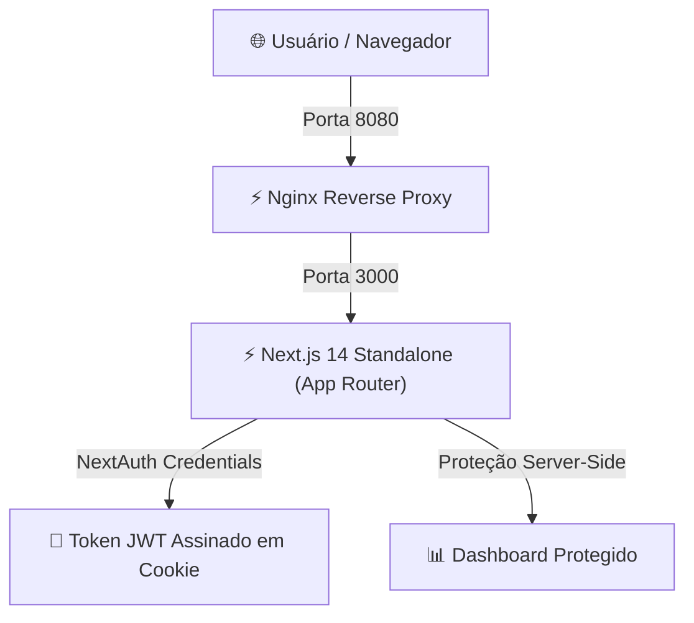

<div align="center">

# 🔐 Login NextAuth — Next.js 14 & Credentials Provider

<p align="center">
  
</p>

[](https://nextjs.org/)
[](https://www.typescriptlang.org/)
[](https://tailwindcss.com/)
[](https://daisyui.com/)
[](https://next-auth.js.org/)
[](https://www.docker.com/)
[](#)

<cite>Aplicação de autenticação stateless completa com NextAuth.js (Credentials Provider), suporte a tokens JWT, proteção de rotas no servidor, botões de login rápido em 1 clique e containerização Docker otimizada.</cite>

</div>

---

## 📌 Visão Geral

O projeto **Login NextAuth** demonstra o padrão de arquitetura ideal para autenticação de usuários por credenciais no Next.js 14 utilizando o NextAuth.js (v4):

- **Autenticação Baseada em JWT:** Sessão segura gerenciada por cookies HTTP, sem dependência de banco de dados no momento da validação de rotas.
- **Proteção Server-Side e Client-Side:** Validação no servidor via `getServerSession` e componentes de cliente reativos.
- **Perfis Demo em 1 Clique:** Três perfis de teste pré-configurados para validação instantânea sem digitação.
- **Stack Docker Otimizada:** Build standalone do Next.js servido via Nginx na porta 8080 com cache de assets e gzip.

---

## 🏛️ Arquitetura da Solução



---

## ✨ Funcionalidades

- **Formulário de Credenciais:** Entrada tradicional de e-mail e senha com feedback de erros visual.
- **Login Rápido (1 Clique):** Botões diretos para conectar como Administrador, Gerente ou Operador.
- **Dashboard do Usuário:** Exibição do nome, e-mail, perfil ativo e status da sessão.
- **Logout Seguro:** Limpeza atômica do cookie JWT e redirecionamento para a tela inicial.
- **Endpoint de Health Check:** Rota `/api/health` para monitoramento.

---

## 👥 Perfis de Acesso & Demonstração (1 Clique)

Na tela de login (`/`), você pode se conectar imediatamente com qualquer um dos perfis abaixo:

| Perfil | E-mail | Senha | Permissões |
|---|---|---|---|
| **Administrador** | `admin@authdemo.com` | `Password@123` | Acesso total e gerenciamento |
| **Gerente** | `gerente@authdemo.com` | `Password@123` | Gestão de operações |
| **Operador** | `operador@authdemo.com` | `Password@123` | Atendimento ao cliente |
| **Dev (Legado)** | `gabriel@email.com` | `123` | Conta original de desenvolvimento |

---

## 🛠️ Tecnologias Utilizadas

- **Framework:** Next.js 14.1.4 (App Router)
- **Linguagem:** TypeScript 5.0
- **Estilização:** Tailwind CSS & DaisyUI 4.10
- **Autenticação:** NextAuth.js v4 (Credentials Provider & JWT)
- **Servidor Web:** Nginx 1.25 Alpine
- **Conteinerização:** Docker & Docker Compose v2

---

## 🚀 Como Executar

### 1. Clonar o Repositório
```bash
git clone https://github.com/omartins-zs/login_next_auth.git
cd login_next_auth
```

### 2. Execução com Docker (Recomendado)
```bash
# Configurar variáveis de ambiente
cp .env.example .env

# Subir a stack completa
docker compose up -d --build
```
Acesse [http://localhost:8080](http://localhost:8080).

### 3. Execução Local (Host)
Consulte as instruções detalhadas em [`docs/COMO_EXECUTAR_LOCAL.md`](file:///C:/Projetos/login_next_auth/docs/COMO_EXECUTAR_LOCAL.md).

---

## 📚 Documentação Complementar

- [Acessos, Credenciais e Testes](file:///C:/Projetos/login_next_auth/docs/ACESSOS_TESTES.md)
- [Como Executar - Visão Geral](file:///C:/Projetos/login_next_auth/docs/COMO_EXECUTAR.md)
- [Como Executar Localmente](file:///C:/Projetos/login_next_auth/docs/COMO_EXECUTAR_LOCAL.md)
- [Como Executar com Docker Compose](file:///C:/Projetos/login_next_auth/docs/COMO_EXECUTAR_DOCKER.md)

---

<div align="center">

Feito com ❤️ por **[Gabriel Martins](https://github.com/omartins-zs)** 🚀

</div>
